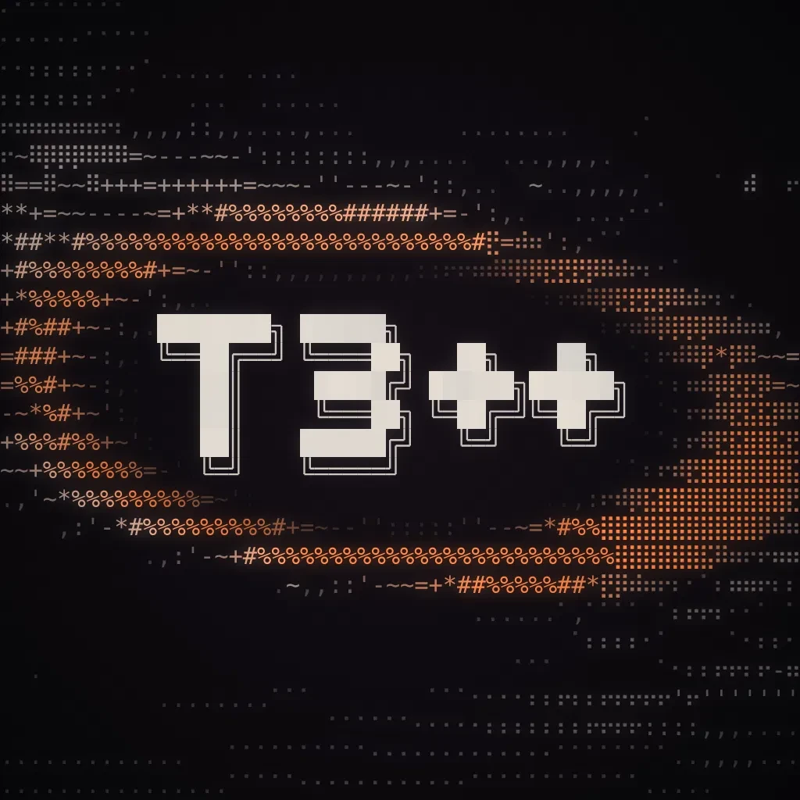
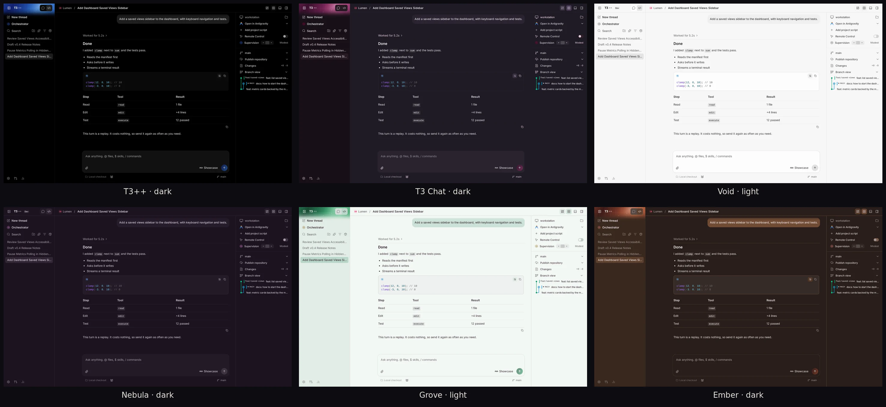
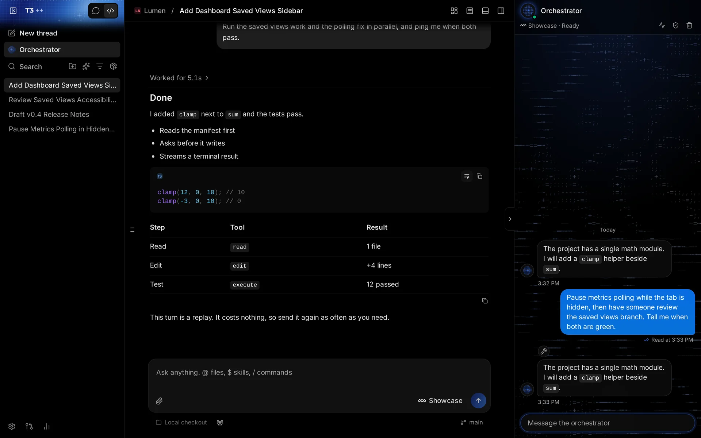
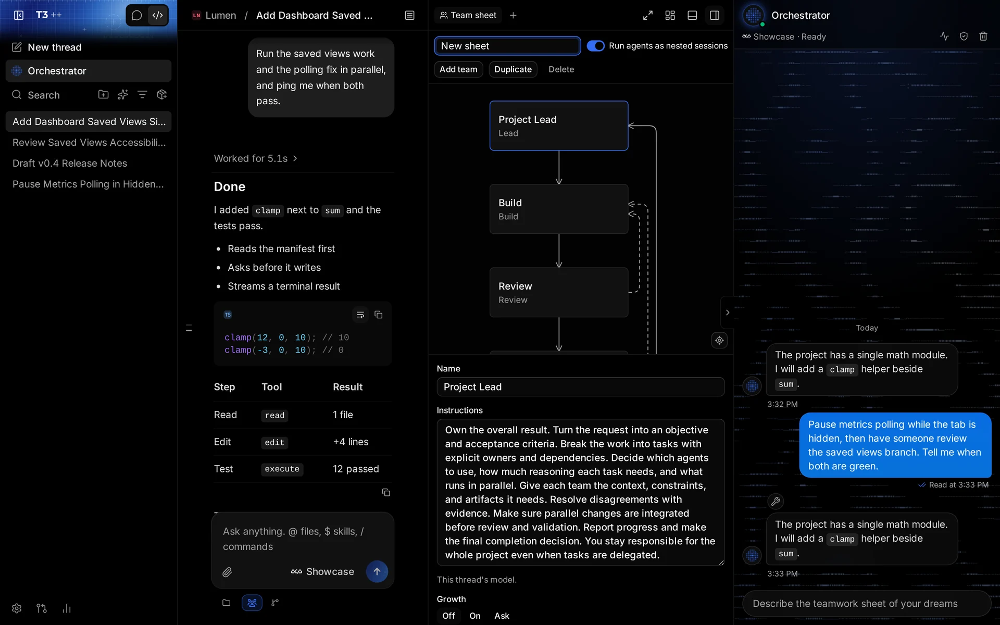
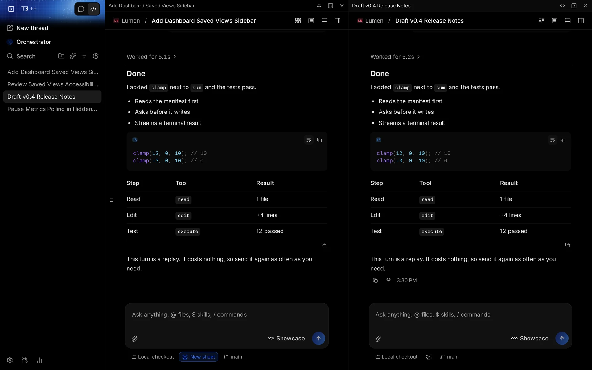
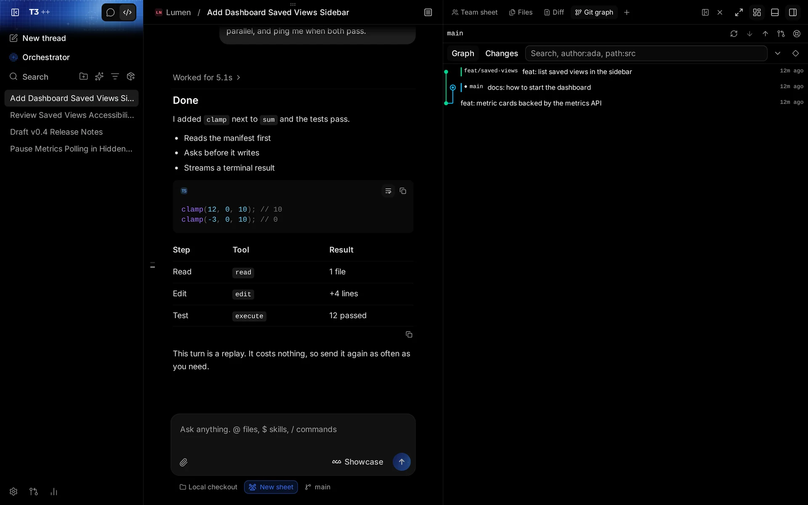
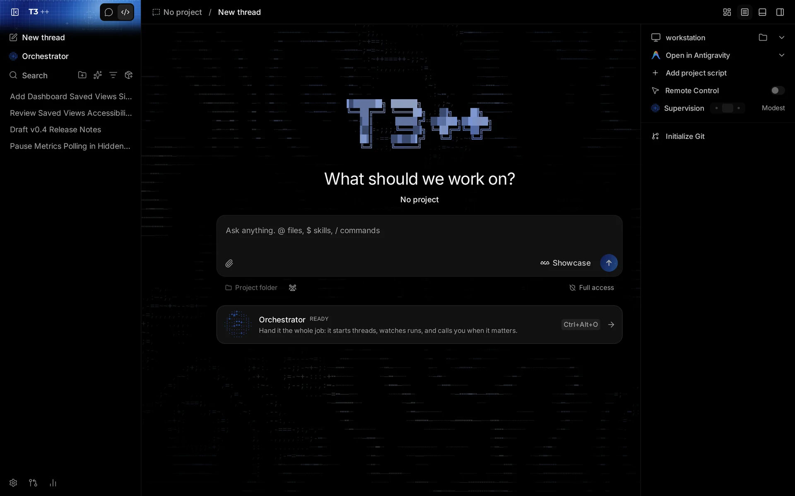

<p align="center">
  
</p>

<p align="center">
  <b>One fast, open app for the coding agents you already pay for.</b><br />
  Claude Code, Codex, Cursor, Grok Build, OpenCode, Antigravity, and fx, from your desktop, your browser, or your phone.
</p>

<p align="center">
  <a href="#install">Install</a> ·
  <a href="#what-t3-adds">What T3++ adds</a> ·
  <a href="./docs/user">Docs</a> ·
  <a href="https://github.com/Kayyo321/T3-plus-plus/releases">Releases</a>
</p>

<p align="center">
  
</p>

## Install

Paste one line. It installs the desktop app and the `t3pp` command from the latest [GitHub Release](https://github.com/Kayyo321/T3-plus-plus/releases), and checks every download against the release's checksums.

**macOS and Linux**

```bash
curl -fsSL https://raw.githubusercontent.com/Kayyo321/T3-plus-plus/main/install.sh | sh
```

**Windows** (Command Prompt or PowerShell), or download [`install.bat`](https://raw.githubusercontent.com/Kayyo321/T3-plus-plus/main/install.bat) and double-click it:

```bash
powershell -c "irm https://raw.githubusercontent.com/Kayyo321/T3-plus-plus/main/install.bat | iex"
```

On a machine without a display, or over SSH, it installs only `t3pp`, the headless server. Run `t3pp` to start it and open the web app, or `t3pp up` to reach it from your other devices.

**Update:** run the same line again. The desktop app also updates itself, and `t3pp update` updates the command.

**Uninstall:** add `uninstall`. Your projects, threads, and settings are kept.

```bash
curl -fsSL https://raw.githubusercontent.com/Kayyo321/T3-plus-plus/main/install.sh | sh -s -- uninstall
```

```bash
powershell -c "& ([scriptblock]::Create((irm https://raw.githubusercontent.com/Kayyo321/T3-plus-plus/main/install.bat))) uninstall"
```

[Install and first run](./docs/user/install.md) covers the options, manual downloads, and Intel Macs.

> [!NOTE]
> T3++ drives the agent CLIs on your machine, so install and sign in to at least one: [Codex CLI](https://developers.openai.com/codex/cli) (`codex login`), [Claude Code](https://claude.com/product/claude-code) (`claude auth login`), [Cursor CLI](https://cursor.com/cli) (`agent login`), [Grok Build](https://x.ai/cli) (`grok login`), [OpenCode](https://opencode.ai) (`opencode auth login`), or [fx](https://fx.sh) (`fx login`, [setup](./docs/user/providers-fx.md)). Antigravity installs and signs in from **Settings → Providers**.

## What T3++ adds

T3++ is built on [T3 Code](https://github.com/pingdotgg/t3code). It keeps everything that makes T3 Code good (it's fast, open, and works remotely) and adds the tools for running many agents at once.

### An orchestrator that runs the job for you



The orchestrator is an agent docked beside your conversations that operates T3++ itself. Hand it the whole job: it starts threads, watches runs, tidies the sidebar, and messages you when something needs you. Supervision modes and grants decide what it may touch. [Orchestrator](./docs/user/orchestrator.md)

### Teams of agents, drawn as a flow chart



Teamwork runs a request through a team on a **sheet**: a Project Lead plus teams that build, review, and validate. Edit the chart, save sheets you like, and turn one on from the composer. A run board shows every team's progress. [Teamwork](./docs/user/teamwork.md)

### Split view, saved layouts, and IDE mode



Put conversations side by side, dock files, diffs, terminals, and a browser around them, and save the arrangement. Focus, Review, Debug, Pair, and IDE are one click away in **Layouts**. [Layouts](./docs/user/layouts.md)

### Git where the work is



A branch view and a full Git graph sit beside every conversation, with a guided flow for conflicts and recovery points before risky operations. Pull requests come from GitHub, GitLab, Forgejo, Gitea, Bitbucket, Azure DevOps, or GitCafe. [Source control](./docs/user/source-control.md)

### Conversations that branch, nest, and rewind

- **Rewind and fork** from any message, with or without the file changes. [Rewind and fork](./docs/user/rewind-and-fork.md)
- **Nested sessions** keep long side work running under a conversation you can still talk to. [Nested sessions](./docs/user/nested-sessions.md)
- **Background tasks** run tests, dev servers, and watchers without blocking the agent. [Background tasks](./docs/user/background-tasks.md)

### Organized your way

- **Chat and Code** each get their own tab and folders, plus smart folders such as **Running** and **Needs input** that gather conversations by state. [Conversation folders](./docs/user/conversation-folders.md)
- **Workspaces** bundle working folders and secrets, from encrypted storage or 1Password, so each project runs with the right credentials. [Workspaces](./docs/user/workspaces.md)

### Reach it from anywhere

Share a conversation with your phone or another computer as a plain web page, with the access you choose, through your local network, Tailscale, or a private relay you own. [Remote control](./docs/user/remote-control.md) · [Remote access](./docs/user/remote-access.md)

### Make it look like yours



More than a dozen themes, each in light and dark, a different theme for each mode if you like, your own palettes or imported VS Code themes, comfortable and compact density, and an animated ASCII start screen. [Appearance](./docs/user/appearance.md)

## Documentation

Full docs live in [docs/](./docs).

- [FAQ](./docs/user/faq.md)
- [Install and first run](./docs/user/install.md)
- [Keeping app and server in sync](./docs/user/updating.md)
- [Permission modes](./docs/user/permission-modes.md)
- [Keyboard shortcuts](./docs/user/keybindings.md)
- [Project settings](./docs/user/project-settings.md)
- [Remote access from a phone or another machine](./docs/user/remote-access.md)
- [Connect Claude Code, Codex, ChatGPT, and other agents over MCP](./docs/user/outside-agents.md)
- Multiple accounts: [Codex](./docs/user/providers-codex.md) · [Claude](./docs/user/providers-claude.md)
- [Run T3++ as a background service](./docs/user/background-service.md)

Building from source? Start at [docs/internals/overview.md](./docs/internals/overview.md). Cutting a release? See [docs/operations/release.md](./docs/operations/release.md).

## Contributing

We are very early. Expect bugs, and expect big features to land fast. Bug reports and small fixes are welcome; read [CONTRIBUTING.md](./CONTRIBUTING.md) first, and report problems in [Issues](https://github.com/Kayyo321/T3-plus-plus/issues).

T3++ uses [Vite+](https://viteplus.dev/guide/), so install the global `vp` tool, then install dependencies:

```bash
curl -fsSL https://vite.plus | bash
```

```bash
vp i
```

On Windows, install `vp` with `irm https://vite.plus/ps1 | iex`.

## Credits

T3++ is a fork of [T3 Code](https://github.com/pingdotgg/t3code), made by the T3 team and released under the MIT license. If T3++ is useful to you, star [T3++](https://github.com/Kayyo321/T3-plus-plus) and [T3 Code](https://github.com/pingdotgg/t3code) too.
